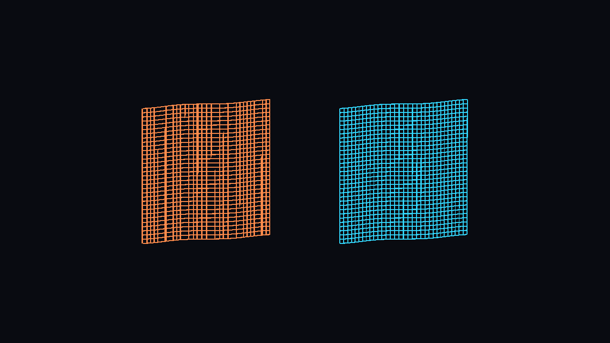

# Stable Projection for Unity URP

[](https://github.com/rsklnkff/urp-stable-projection/actions/workflows/source-validation.yml)

A URP patch to reduce vertex jitter far from the world origin.

I ran into this while working on **Void Logistics**. Close-up views of ships would wobble as the camera moved, even though their parts had accurate local positions. This package contains the rendering fix, along with an installer and a small demo.

It changes how URP projects vertices, including shadow and motion-vector passes. World coordinates keep their usual meaning, so physics, saves and gameplay code don't need to change. Standard URP shaders and custom shaders that use the shared projection helpers pick up the fix without individual edits.



The same geometry and camera at coordinates around 240,000 units. Orange uses conventional projection; cyan uses the patched helpers.

## Compatibility

| Unity | URP | Testing |
|---|---|---|
| 2022.3 | 14.0.12 | GPU precision, shader compilation, install and restore |
| 6.0 | 17.0.4 | Source checks only |
| 6.1 | 17.1.0 | Source checks only |
| 6.2 | 17.2.0 | GPU precision and shader compilation |
| 6.3 | 17.3.0 | GPU precision, shader compilation, install/restore and a Windows Player smoke test |

DX11 checks pass on the three runtime-tested versions. Vulkan checks pass on URP 17.2. **DX12 currently fails a precision test and isn't supported.** XR and other graphics backends haven't been validated.

Other patch releases in these URP families may work, but must pass the installer's source checks. Unsupported versions are refused. See [the full results and known limitations](docs/COMPATIBILITY.md).

## Install

Your project needs to be using a supported URP version already. Commit or back up your work first.

In Package Manager, choose **Add package from Git URL**:

```text
https://github.com/rsklnkff/urp-stable-projection.git?path=/Packages/com.voidlogistics.urp-stable-projection#v0.1.0
```

1. Open **Tools > Stable Projection > Installer** and click **Check compatibility**.
2. Click **Install checked patch** and wait for package resolution and shader imports.
3. Click **Validate installed patch**, then run **Tools > Stable Projection > Run GPU precision validation** in Edit Mode.

The installer patches copies of your installed Core and URP packages and packs them into `.tgz` files. There's no need to commit thousands of unpacked Unity source files. Unity may show a missing-signature notice for these modified packages.

Commit the following together:

- `Packages/manifest.json` and `Packages/packages-lock.json`
- `Packages/StableProjectionArchives/*.tgz`
- `ProjectSettings/StableProjection.install.json`

There's also a [ZIP download](https://github.com/rsklnkff/urp-stable-projection/releases/tag/v0.1.0) with [disk-install instructions](docs/INSTALLATION.md#package-manager-disk-installation).

## Try it

Choose **Tools > Stable Projection > Create comparison demo scene**, then press Play. You can move the camera, change zoom, switch to perspective, or bring everything back to the origin. The demo creates its own folder under `Assets/StableProjectionDemo`.

## Orthographic cameras

The shader patch helps both perspective and orthographic rendering. For an orthographic camera, you can also add `PreciseOrthographicCamera` to reduce whole-view jitter caused by rounding in the camera transform.

It calculates the camera rig's position from local transforms using doubles. If your game already tracks the camera in double precision, pass its position each frame after moving it:

```csharp
preciseCamera.SetPrecisePosition(cameraX, cameraY, cameraZ);
```

Pass the camera's final position, including rig offsets. This component controls the projection matrix, so it shouldn't run alongside another script that also sets a custom projection. Disabling it restores the normal projection.

## Performance and limits

I've tested the original fix in Void Logistics Player builds, including on Steam Deck and a laptop RTX 3050, and haven't noticed a performance difference. It does add vertex arithmetic, so the cost will depend on your game and hardware.

This fixes precision lost during projection. It can't recover detail already lost in CPU transforms, world-space particles or batched geometry. Custom shaders doing their own matrix math may need changes. Test your rendering features in a Player build before shipping.

See [how it works](docs/IMPLEMENTATION.md), [test instructions](docs/VALIDATION.md), or [contributing](CONTRIBUTING.md).

## Removing or upgrading

Use **Restore original packages** before upgrading URP or removing this package. Keep the install record until restoration is complete. After upgrading, run the compatibility check again and generate new archives.

See [installation and recovery](docs/INSTALLATION.md) for details.

## License

[Unity Companion License](LICENSE.md), for Unity-dependent projects. Unity's existing copyright and third-party notices are preserved. This is a community project, not an official Unity package.
